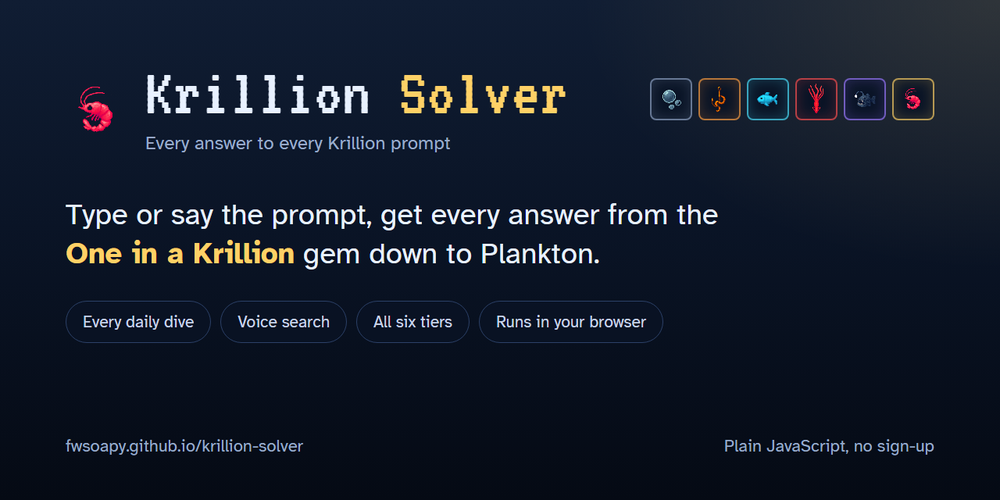

# Krillion Solver



**[Open the solver](https://fwsoapy.github.io/krillion-solver/)**

Type a [Krillion](https://krillion.io) prompt and see every accepted answer, from the One in a Krillion gem down to Plankton. Click an answer to copy it. Tap the mic and say the prompt; it snaps to the closest one, so "2024 winner olympics" still finds the Winter Olympics prompt.

It covers every daily dive since dive #1 on July 16, 2026.

## The extension

`extension/` is a Chrome extension for krillion.io. It reads the prompt off your screen in the daily dive and in Puffer Party and opens a panel with the answers.

- **Crosses off used answers.** In Puffer Party it watches the other players' bubbles and hides every answer someone already gave. Yours drop off once the game accepts them, so a turned-down answer stays on the list. In the daily dive they drop off when you press Enter.
- **Learns party prompts.** Party mode has prompts the daily dive never used. The extension saves every accepted answer it sees, with its tier, so the next time that prompt comes up you get a list.
- **Auto answer** (off by default). On your turn it picks a random unused answer from the tier range you set, types it one key at a time at the speed you pick, and presses Enter. A new question stays up 2 seconds before it starts typing, so you can read it. Switch on "Make mistakes" and it makes typos it backspaces and fixes, and now and then tries an answer said earlier (never the one just said). On a prompt with no list, it guesses from the closest daily prompt's list. Keep it to unrated rooms: in rated ones you move other people's ratings.
- **Pre-type** (party, off by default) types your next answer while someone else holds the puffer, so it goes out the moment the puffer reaches you. If another player says that answer first, it deletes it and types a new one.
- Auto answer types in lowercase. Type in the game's box yourself, or click an answer in the panel, and auto answer switches off on the spot.
- **Auto queue** (off by default) clicks Play again when a party game ends, and takes your seat back if the game kicks you for idling, or joins another room with Quick Play if yours filled up.
- **Contribute answers** (off by default) sends the answers you see on party prompts that have no daily list to the project, so those prompts can get lists for everyone. It sends the prompt, the answer and its tier, nothing about you or the other players. Each answer goes once, at the end of a game or every few minutes, 50 per request with a backlog sent in quick batches. The answers land in a Google Sheet; [`collector/`](collector/README.md) has the script and how to set it up.
- It keeps working in a background tab or a minimized window. Chrome slows a hidden tab's timers, so the extension times its typing and contributing from its background worker instead.
- Click any answer to type it into the game's box.
- Drag the panel by its title bar. Double-click the title to put it back.

To install it:

1. Run `node build.js`
2. Open `chrome://extensions` and switch on Developer mode
3. Click **Load unpacked** and pick the `extension` folder

After a rebuild, click the reload arrow on the extension's card. New daily dives load by themselves, so you only rebuild to pick up new site code.

## Where the answers come from

Krillion doesn't publish its answer sheets, so `update.js` merges three fan archives:

- [krillion.run](https://krillion.run/answers/archive/) has the full list for each day
- [minutecryptic.today](https://minutecryptic.today/krillion-answers) fills in answers and gems krillion.run missed
- [The Word Finder](https://www.thewordfinder.com/misc-solvers/krillion-answers/) covers the one day krillion.run lacks (Nov 3)

Each tier lists the most common answers first, 20 at a time. Where The Word Finder has the real top 10 most-typed answers (the last month), those lead. The rest go by how familiar their words are, using an English word-frequency list ([FrequencyWords](https://github.com/hermitdave/FrequencyWords), CC BY-SA 4.0), the same kind of data Krillion uses to set tiers. It works well for words and names and less well for titles made of everyday words, like a horror film called "They".

The extension also bundles a word list made from the same FrequencyWords list (CC BY-SA 4.0), kept in `data/words.txt`. It answers party prompts like "Name an English word containing “bio”" that have no answer list.

Party answers (`data/party.json`) come from the opt-in collector sheet plus generated answer lists in `collector/generated/`. `collector/sheet.json` is a snapshot of the sheet. To refresh: export the sheet to `collector/sheet.json` (`{ "prompt": ["answer/T"] }`, T = K, D, R, S, T or P from One in a Krillion down to Plankton), then run `node party.js` and `node build.js`.

The last 29 days match The Word Finder's official counts to within a handful of answers. 17 small prompts, like "Name a country that borders Brazil", have no gem in any source. The game seems to skip the gem on short closed lists, and the solver says so.

## Run it yourself

The page loads `data/` with `fetch`, so open it from a local server, not as a file:

```bash
python -m http.server 8000
```

Then go to http://localhost:8000.

```bash
node update.js    # download new days and rebuild data/ (cached in .cache/)
node build.js     # copy the data and match.js into extension/
node test.js      # matching, merging, parsing, and a check of every data file
```

`mock-game.html` copies the game's page structure, judges answers like the game's server and runs the extension's script against it. Add `?test` (party) or `?daily&test` to run `extension-test.js`: dozens of auto-answered turns, typos, lost turns, rejected answers, new questions and auto queue, with a pass or fail for each.

## Keeping it current

`.github/workflows/update.yml` runs `update.js` every morning and commits the new day. Turn on Actions for the repo and it keeps the site up to date.

## License

MIT. Not affiliated with Krillion. The tier art belongs to the game.
